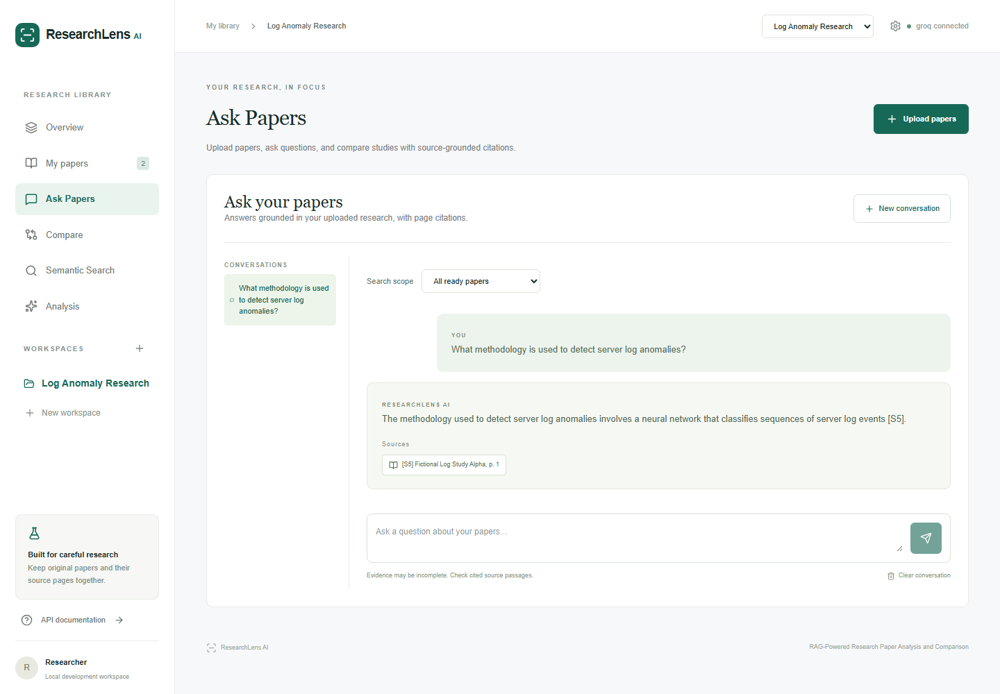
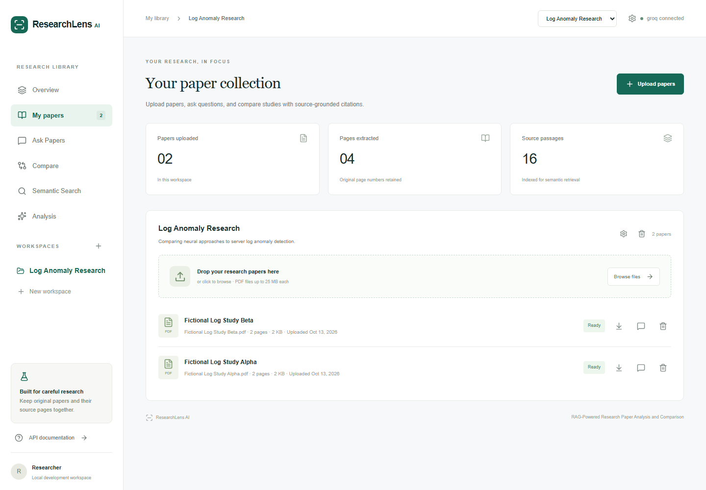
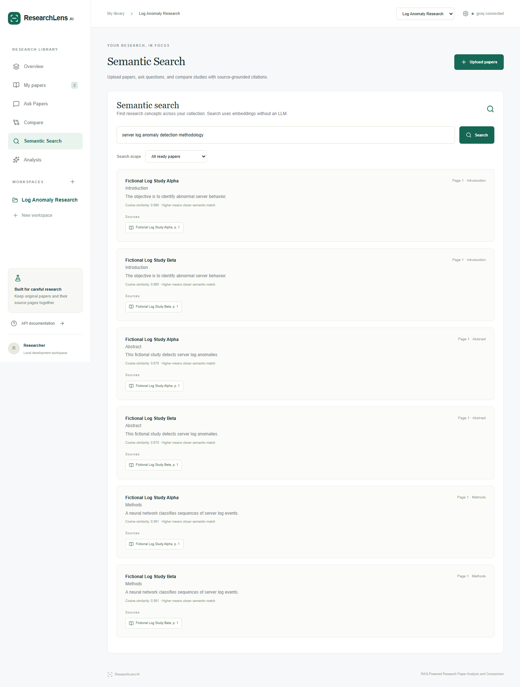
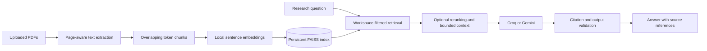

# ResearchLens AI

**Understand research papers faster, with answers you can trace back to the source.**

ResearchLens AI is a research workspace for exploring academic PDFs. Organize papers by topic, search for relevant passages, ask questions with paper and page citations, extract structured findings, and compare studies side by side.

Built with Next.js, FastAPI, local embeddings, and retrieval-augmented generation (RAG). Groq and Gemini provide generation; PDF processing, indexing, and semantic search run without a generation-provider API key.

[Quick start](#quick-start) · [Product preview](#product-preview) · [How it works](#how-it-works) · [Development](#development) · [Documentation](#documentation)


## What you can do

| Feature | What it offers |
| --- | --- |
| Research workspaces | Keep papers and persistent conversations organized by topic. |
| PDF library | Upload multiple papers, track processing, detect duplicates, and retain original page references. |
| Ask Papers | Ask questions across a workspace or selected papers, with citations linked to source passages. |
| Semantic search | Find passages by meaning using local embeddings, without calling an LLM. |
| Paper analysis | Generate summaries and extract research problems, methods, datasets, models, metrics, results, and limitations. |
| Paper comparison | Compare 2–8 papers in a table and narrative, with caveats for incompatible evaluation settings. |
| Persistent retrieval | Reuse FAISS indexes across restarts and recover missing, stale, or corrupted indexes from stored chunks. |
| Retrieval evaluation | Measure page-level Recall@K, Precision@K, and mean reciprocal rank against annotated questions. |

## Product preview

The images below are included from the [mockups](mockups/) folder. They illustrate the research workflow with fictional example papers.

### Ask questions with citations

Ask about methods, findings, or limitations and follow citations back to the supporting paper and page.



<details>
<summary><strong>Explore the paper library, search, analysis, and comparison screens</strong></summary>

### Paper library

Upload PDFs into a workspace and review processing status, page counts, and extracted passages.



### Semantic search

Search your collection for research concepts and inspect matching passages with similarity scores and page references.



### Structured analysis

Review a paper's research problem, objectives, methodology, datasets, results, limitations, and future work alongside its sources.


### Compare studies

Compare approaches and reported results while keeping differences in datasets and evaluation settings visible.


</details>

## Quick start

### Requirements

- Python 3.14 and Node.js 24, matching the repository's documented development environment and Docker images.
- Git and internet access for dependencies and the first embedding-model download.
- A Groq or Gemini API key for chat, summaries, analysis, and comparison.

The commands below use Windows PowerShell. For other platforms, use the equivalent virtual-environment paths or the Docker Compose option.

### 1. Install dependencies

```powershell
git clone https://github.com/Azrul16/researchlens-ai-rag-assistant.git
cd researchlens-ai-rag-assistant

python -m venv .venv
.\.venv\Scripts\python.exe -m pip install -r backend\requirements.txt

cd frontend
npx.cmd --yes pnpm@12.11.2 install --frozen-lockfile
cd ..
```

For an existing checkout, reuse its virtual environment if already configured.

### 2. Configure a provider

Create the root environment file without overwriting an existing configuration:

```powershell
if (-not (Test-Path .env)) { Copy-Item .env.example .env }
```

Edit `.env` with one of these configurations:

```dotenv
# Groq
LLM_PROVIDER=groq
GROQ_API_KEY=your_groq_api_key
```

```dotenv
# Gemini
LLM_PROVIDER=gemini
GEMINI_API_KEY=your_gemini_api_key
```

Only the selected provider needs a key. See [.env.example](.env.example) for model IDs and all available settings. Keep credentials in the ignored `.env` file.

The frontend uses `http://localhost:8000/api/v1` by default. To change it, copy [frontend/.env.example](frontend/.env.example) to `frontend/.env.local` and set `NEXT_PUBLIC_API_URL`.

### 3. Start the app

Double-click [`start.cmd`](start.cmd) in the repository root. The launcher applies migrations, starts both services, waits for readiness, and opens the browser. Keep its terminal open; Ctrl+C or closing the terminal stops the services.

| Service | URL |
| --- | --- |
| Web application | http://localhost:3000 |
| Interactive API docs | http://localhost:8000/docs |
| Health endpoint | http://localhost:8000/api/v1/health |

The embedding model downloads on first use, so the first upload may take longer. Launcher logs are stored in `.logs/`.

<details>
<summary><strong>Manual startup and background services</strong></summary>

Run the backend in one terminal, starting from the repository root:

```powershell
cd backend
..\.venv\Scripts\python.exe -m alembic upgrade head
..\.venv\Scripts\python.exe -m uvicorn app.main:app --reload
```

Run the frontend in another terminal:

```powershell
cd frontend
npx.cmd --yes pnpm@12.11.2 dev
```

Alternatively, start and stop background services from the repository root:

```powershell
powershell -NoProfile -ExecutionPolicy Bypass -File scripts\start.ps1
powershell -NoProfile -ExecutionPolicy Bypass -File scripts\stop.ps1
```

For the optimized frontend, run `npx.cmd --yes pnpm@12.11.2 build` inside `frontend`, then invoke `scripts\start.ps1 -Production` from the root. Stop an existing instance before starting another.

</details>

### Docker Compose

With Docker and Compose installed, configure the root `.env` as above, then run:

```sh
docker compose up --build
```

Compose starts PostgreSQL, the backend, and the frontend at the same URLs listed above. Named volumes retain the database, uploaded documents, indexes, and model cache. Stop the stack with `docker compose down`.

## Research workflow

1. Create a workspace for a topic or literature review.
2. Upload text-based PDFs and wait for their status to become ready. Default limits are 25 MB and 500 pages per paper.
3. Search for concepts across the collection or narrow the scope to selected papers.
4. Ask questions such as “Which datasets do these studies use?” or “What limitations are reported?”
5. Open citations and check the original passages before reusing a claim.
6. Generate a summary or structured analysis, then compare 2–8 papers to explore similarities and differences.

Conversations and cached analyses persist with the workspace. Deleting a paper removes its stored file and chunks and rebuilds the workspace index.

## How it works



The Next.js interface calls a FastAPI backend. SQLite or PostgreSQL stores workspaces, document metadata, chunks, conversations, and cached analyses. PDFs retain page provenance throughout extraction and retrieval; generation uses a bounded selection of evidence passages.

The backend validates source IDs and numerical claims and can return an insufficient-evidence response. These checks reduce unsupported output, but researchers should still inspect the cited evidence. Scanned PDFs requiring OCR, multi-user authentication, distributed workers, and streaming are outside the current MVP. Relevant evidence passages are sent to the configured generation provider for AI features.

### Technology stack

| Layer | Technologies |
| --- | --- |
| Frontend | Next.js 16, React 19, TypeScript, Tailwind CSS 4, Lucide |
| Backend | FastAPI, Pydantic, Uvicorn |
| Storage | SQLAlchemy async sessions, Alembic, SQLite or PostgreSQL |
| Document processing | PyMuPDF and token-based chunking |
| Retrieval | Sentence Transformers, FAISS CPU, optional CrossEncoder reranking |
| Generation | Groq and Gemini provider adapters |
| Checks and packaging | pytest, Ruff, ESLint, TypeScript, Playwright, GitHub Actions, Docker Compose |

### Configuration

Common settings are defined in [.env.example](.env.example):

| Setting | Purpose / default |
| --- | --- |
| `DATABASE_URL` | SQLite by default; PostgreSQL is supported. |
| `LLM_PROVIDER` | Select `groq` or `gemini`. |
| `EMBEDDING_MODEL` | Defaults to `sentence-transformers/all-MiniLM-L6-v2`. |
| `CHUNK_SIZE` / `CHUNK_OVERLAP` | 900 / 120 tokens. |
| `RETRIEVAL_TOP_K` / `FINAL_CONTEXT_K` | Retrieve 8 candidates and retain up to 5 context chunks. |
| `ENABLE_RERANKER` | Optional reranking; disabled by default. |
| `MAX_UPLOAD_MB` / `MAX_PDF_PAGES` | 25 MB / 500 pages per PDF. |
| `API_TOKEN` | Optional shared API access token. |

## Development

Run backend checks from `backend`:

```powershell
..\.venv\Scripts\python.exe -m pytest
..\.venv\Scripts\python.exe -m ruff check .
```

Run frontend checks from `frontend`:

```powershell
npx.cmd --yes pnpm@12.11.2 lint
npx.cmd --yes pnpm@12.11.2 typecheck
npx.cmd --yes pnpm@12.11.2 build
npx.cmd --yes pnpm@12.11.2 test:e2e
```

See [verification notes](docs/verification.md) for browser and live-provider prerequisites, recorded checks, and their limits. These commands describe how to validate the application; live AI checks consume provider quota.

### Repository guide

```text
backend/       FastAPI routes, RAG pipeline, provider adapters, migrations, tests
frontend/      Next.js interface, browser tests, screenshot tooling
mockups/       Product images featured in this README
docs/          Architecture, API, RAG, and verification documentation
scripts/       Launchers, readiness checks, and publication audit
data/          Local application data (generated runtime files are ignored)
compose.yaml   PostgreSQL, backend, and frontend services
```

## Documentation

- [Architecture](docs/architecture.md) — components, storage, and service boundaries.
- [RAG pipeline](docs/rag-pipeline.md) — ingestion, retrieval, context, and validation.
- [API reference](docs/api.md) — backend endpoints and request formats.
- [Verification notes](docs/verification.md) — checks performed and remaining limits.
- [Release audit](docs/release-audit.md) — publication review notes.
- [Project specification](PROJECT_SPEC.md) — detailed requirements and scope.
- [Third-party notices](THIRD_PARTY_NOTICES.md) — dependency and asset notices.

## License

Released under the [MIT License](LICENSE).
