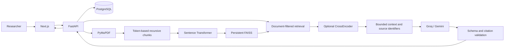

# Architecture

ResearchLens AI uses a Next.js App Router frontend, a FastAPI API, async SQLAlchemy repositories/services, PostgreSQL, PyMuPDF, Sentence Transformers, and exact FAISS inner-product indexes over normalized vectors. SQLite is available for local development and tests.

## Boundaries

- `api/`: HTTP validation and orchestration.
- `services/`: PDF ingestion, embeddings, vector operations, conversations and research analysis.
- `rag/`: evidence context, prompts, numerical guards and citation mapping.
- `llm/`: vendor-neutral generation, provider adapters and schema validation.
- `db/`: ORM models, async sessions and database configuration.
- `evaluation/`: explicit retrieval measurement outside normal requests.

Routes expose database records through Pydantic schemas; internal file paths and credentials are never returned. The frontend uses a central API client and typed results. Markdown renders without raw HTML. Citation drawers display stored excerpts and open the original PDF page.

## Persistence and recovery

The relational database stores workspace, document, chunk, conversation, message and cached-analysis records. `users` and nullable workspace ownership allow later identity integration. The initial application is a single-tenant research library; `API_TOKEN` can protect it, and is required with `APP_ENV=production`. The schema does not imply multi-user access control.

PDFs use generated UUID filenames. Each workspace has `index.faiss`, `metadata.json` and a lock file. Metadata records ordered chunk IDs, embedding model identity and a SHA-256 index checksum. Retrieval verifies these against authoritative database chunks and rebuilds when files are missing, corrupted, stale, or configured for a different model. Atomic file replacement and a cross-process workspace lock prevent partial generations being served. Interrupted `processing`/`extracted` documents are recoverable by rebuild. Failed embeddings preserve extracted text for retry.

Deleting a document deletes its chunks, analysis cache and PDF, then rebuilds its workspace index. Conversation citation excerpts remain available historically, with a deleted-source indicator. Deleting a workspace also deletes conversations/messages and index artifacts; lightweight lock files may remain to keep cross-process locking safe.

## Operational limits

PDF ingestion is synchronous with parsing/embedding in a thread pool; the UI shows upload progress and a processing state. Large jobs should move to Celery/RQ workers. In-memory rate limits are per process; use Redis or a gateway for multiple workers. Native file locks require a shared filesystem with reliable locking semantics. FAISS FlatIP performs exact search and scales linearly; document filtering is accurate because it considers all candidates before taking top K.

Future substitutions: FAISS to pgvector/Qdrant, disk storage to S3/MinIO, local locks to worker jobs, simple API token to OAuth and ownership enforcement, vector search to hybrid BM25/vector retrieval, PyMuPDF to OCR/table-aware extraction.
